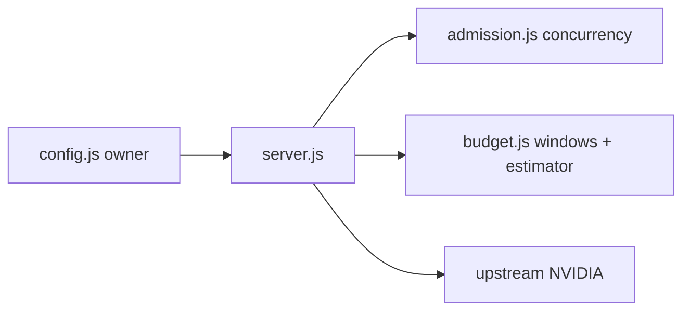

# e04s04: Enforce global RPM/TPM budgets with Safety margin

* Issue: [#17](https://github.com/ak-a-ra/nvidia-api-proxy/issues/17)
* Parent issue: [#13](https://github.com/ak-a-ra/nvidia-api-proxy/issues/13)
* Type: feat
* Risk: P0
* Context: infra
* Status: passing

## 1. Business narrative

The proxy validates `PROXY_RPM` and `PROXY_TPM` since e04s01 but never reads
them again, so an operator who sets a budget gets no budget: a single client
loop can consume the shared NVIDIA key's quota and take every other caller down
with a 403 from upstream. This story turns the validated pair into a live
enforcement point. Rate limiting stays opt-in and default-off — a deployment
without the pair behaves exactly as it did before, fully streaming and
unbuffered — and a deployment with the pair pays for it in one place: request
bodies are buffered to estimate their cost before the upstream is contacted.

The operator-facing trade is deliberate and stated in the issue: buffering is
the price of knowing what a request will cost. It exists only in rate-limit
mode, only to extract metadata and enforce a body-size cap, and it forwards the
original bytes byte-for-byte.

## 2. Problem statement

A validated-but-unenforced budget is a budget that appears to exist and does
not. Enforcing it requires three things the codebase did not have: an estimator
that turns a request body into a token cost before the upstream is contacted, a
rolling window that holds the last 60 seconds of usage rather than a counter
that resets, and a gate in the request path that reserves cost against that
window and answers 429 when it cannot. The gate must not disturb the streaming
path it does not need, must not decode bodies it forwards, and must not answer
a request with a body the upstream would have rejected anyway.

## Requirements (delta tags)

### ADDED: Rate limiting activates only on a complete pair

When both `PROXY_RPM` and `PROXY_TPM` are present as valid positive integers,
the proxy enforces global budgets. Both absent or blank leaves rate limiting
disabled. Exactly one nonblank remains fatal at startup, unchanged from e04s01.

### ADDED: A rolling 60-second window pair

`budget.js` holds two event histories: one charge per admitted request (RPM)
and one cost per reservation (TPM). Each cost expires exactly 60 seconds after
it was reserved. A quiet minute reads as an empty window.

### ADDED: Safety margin arithmetic

The effective limit is `max(1, floor(limit * (1 - margin / 100)))`, with the
margin defaulting to 5 and bounded 0–50. `budget.js` computes both effective
limits once at construction.

### ADDED: A cost estimator

Messages, tool definitions, and requested output are estimated. Requested
output defaults to 1024 tokens and is capped at 4096. Bodies that cannot be
inspected — encoded, malformed JSON, non-JSON, no model, unknown model — use a
fallback of four characters per token rounded up with a minimum of one token.

### ADDED: A buffered-body path with a byte cap

Rate-limit mode reads the request body up to `PROXY_MAX_BUFFERED_BODY_BYTES`
(default 8,388,608). A body above the cap is answered `413` with exact body
`{ "error": "Request too large" }`, never reaches the upstream, and leaves the
proxy usable.

### ADDED: An over-budget 429 arm

A reservation that cannot be made is answered `429` with exact body
`{ "error": "Too many requests" }` and a positive `Retry-After` derived from
the window's own oldest live reservation. It never queues upstream work.

### MODIFIED: The request path gains a rate-limit gate

The gate sits between the configured check and admission: buffer the body,
estimate, reserve, and only then take a concurrency ticket.

### MODIFIED: `budget.js` is a shipped file

`eslint.config.js`, `package.json` scripts, and the "files that ship" comments
now name three runtime files, not two.

### MODIFIED: Test count and the enforcement status of the budget pair

The e04s01 test that asserted a tiny budget still proxies normally is updated
to assert the budget is enforced, as its own comment required.

### REMOVED: Nothing

## 3. Actors

* **Client application** — calls `/v1/*` with a Bearer token and a request body.
* **Proxy** — admits, estimates, reserves, forwards.
* **Upstream (NVIDIA NIM)** — sees the original bytes, never the estimate.
* **Operator** — sets `PROXY_RPM`, `PROXY_TPM`, `PROXY_SAFETY_MARGIN_PCT`,
  `PROXY_MAX_BUFFERED_BODY_BYTES`.

## 4. Preconditions

* `NVIDIA_BASE_URL` valid http(s), `NVIDIA_API_KEY` and `PROXY_AUTH_TOKEN` set
  (else the 503 arm from ADR 0001 answers first, unchanged).
* Rate limiting disabled when the pair is absent or blank.
* Both budget variables valid positive integers, margin in 0–50, body cap a
  positive integer — all parsed by `config.js` as before, no parsing change.

## 5. Solution and main flow

1. `config.js` parses and validates as it already does. No new variables.
2. `server.js` builds `budget = createBudget(config.rateLimit, config.limits)`
   once at startup. A null rate pair builds a gate that fails open.
3. On a request: auth (401) → unconfigured (503) → path check (404) → rate gate.
4. Rate gate, only when enabled:
   a. Buffer the body up to the byte cap (413 on overflow, or silent return if
      the client is gone).
   b. Estimate the cost from the parsed JSON, or fall back to bytes/4.
   c. Reserve against the window. Rejected → 429 with the derived Retry-After.
   d. Admitted → continue.
5. `admission.acquire` as before (concurrency ceiling and queue unchanged).
6. Forward: the buffered bytes are the body; `content-length` is restored from
   the buffer so undici does not reframe the caller's request as chunked.

### Module map after this story



## 6. Constraints and alternative flows

* **Budget waiting is not implemented in this slice.** A wait would park a
  caller — and a concurrency slot — for up to 59 seconds to reach a state only
  the clock controls. The slice answers immediately instead, with a real
  `Retry-After` derived from the window. The bounded wait worth having (an
  early release by a disconnected client) lands with the per-model budget in
  e04s05, where holding a client is worth the slot. This is a deliberate
  divergence from issue #17's AC bullet 10, recorded in §17 and in the ADR
  amendment.
* **No decoding.** A gzip body is estimated from its compressed length and
  forwarded compressed. The proxy holds no plaintext copy of an encoded body.
* **No refund.** A reservation is never handed back; the window ages it out.
  A manual refund would let one retry spend the same minute twice.
* **No per-model enforcement.** `PROXY_MODEL_LIMITS_JSON` is still validated
  and stored only (e04s05).
* Alternative rejected: refill-rate token buckets. They need a timer, which
  makes "the last 60 seconds" untrue, and a tick is a polling source the issue
  forbids.

## 7. Domain glossary

* **Reservation** — one estimated cost held against the TPM window, plus one
  RPM charge.
* **Rolling window** — a bounded event history, pruned on read, never reset.
* **Effective limit** — a configured limit with the Safety margin removed,
  floored at one.
* **Fallback estimate** — four characters per token, minimum one, for bodies
  the estimator cannot inspect.

## 8. Interfaces and contracts

`budget.js` exports:

```
createBudget(rateLimit, limits) -> { enabled, effective, reserve, release, close }
estimateCost(json, buffer) -> { inputTokens, outputTokens, requestCharge, totalTokens, fallback }
effectiveLimit(limit, safetyMarginPct) -> number
```

* `reserve(cost)` returns `{ admitted: true, cost }` or
  `{ admitted: false, reason, retryAfter }`. Decided against one pruned
  snapshot, so no two concurrent requests both see the last free token.
* Disabled gate: `reserve` returns `{ admitted: true }` and allocates nothing.
* `server.js` imports only those names; `admission.js` is untouched.

## 9. Configuration

No new variables. The four budget variables change from "validated and stored"
to "read at request time":

| Variable | Before | After |
|---|---|---|
| `PROXY_RPM` | stored | RPM ceiling of the rolling window |
| `PROXY_TPM` | stored | TPM ceiling of the rolling window |
| `PROXY_SAFETY_MARGIN_PCT` | stored | applied to both effective limits |
| `PROXY_MAX_BUFFERED_BODY_BYTES` | stored | body cap enforced in rate-limit mode |

## 10. Data and state

Window state lives in `budget.js` only, as two arrays pruned on read. No
persistence, no cross-request state elsewhere. `config.js` remains the single
owner of defaults and parsing.

## 11. Invariants

1. Rate limiting disabled ⇒ zero behavioral change, no body buffered.
2. Disabled mode streams bodies above the buffer cap without a 413.
3. One RPM charge per admitted request.
4. TPM reserved before the upstream is contacted.
5. Effective limits floored at one.
6. Reservation decided atomically against a pruned snapshot.
7. 413 and 429 bodies are exact; `Retry-After` is always positive.
8. Rejections never reach the upstream and leave the proxy usable.
9. Forwarded bytes equal the caller's bytes, headers preserved.

## 12. Failure modes

| Failure | Answer |
|---|---|
| Body above cap | `413 { "error": "Request too large" }` |
| Over budget | `429 { "error": "Too many requests" }` |
| Client gone mid-body | silent, no answer |
| Budget closed under a request (SIGTERM) | rejection, silent |
| Upstream failure | `502 { "error": "Bad gateway" }` unchanged |

## 13. Security and privacy

* No secret in any new path: the 429 body is generic, no header or token
  reaches it.
* The buffer is held in memory only as long as the request; `budget.js` never
  retains it (the estimator returns counts).
* Encoded bodies are never decompressed, so no plaintext copy is created.
* Auth is unchanged (digest + `timingSafeEqual`).

## 14. Observability

No new log line in this slice. The log line's closed field set is unchanged;
the rate gate adds nothing to it.

## 15. Dependencies

None added. `budget.js` uses only `Date.now` and array operations.

## 16. Risks and assumptions

* **Buffering cost** — memory bounded by the byte cap; a body at the cap costs
  8 MiB per concurrent rate-limited request. Documented, default 8 MiB.
* **Estimator accuracy** — an estimate that under-counts will overspend; the
  Safety margin is the operator's control.
* **Latency** — buffering delays the first upstream byte until the body is
  fully read.

## 17. Acceptance criteria (Gherkin)

```gherkin
Feature: global RPM/TPM budgets with Safety margin

  Scenario: both rate variables absent
    Given PROXY_RPM and PROXY_TPM are unset
    When a client posts a body larger than the buffer cap
    Then the body is streamed through without a 413
    And the response matches the no-rate-limit build

  Scenario: budget enforcement is active
    Given PROXY_RPM and PROXY_TPM are set
    When a request body is above PROXY_MAX_BUFFERED_BODY_BYTES
    Then the status is 413
    And the body is exactly { "error": "Request too large" }
    And the upstream receives no request
    And a following in-budget request succeeds

  Scenario: over the effective TPM
    Given PROXY_RPM and PROXY_TPM are set
    When a request's estimated cost exceeds the effective TPM
    Then the status is 429
    And the body is exactly { "error": "Too many requests" }
    And the Retry-After header is a positive integer
    And the upstream receives no request

  Scenario: the effective limit is floored at one
    Given PROXY_RPM 1 and PROXY_TPM 1 with default margin
    Then the effective limits are both 1
    And an ordinary request is over budget and answered 429

  Scenario: bodies are forwarded byte-identically
    Given rate limiting is enabled
    When the body is canonical JSON, non-canonical JSON, malformed JSON,
      Unicode, gzip, or non-JSON
    Then the upstream receives the caller's exact bytes
    And the caller's content-encoding and content-type are intact

  Scenario: RPM counts once per admitted request
    Given PROXY_RPM 3 with margin 0
    When three requests arrive
    Then all three are admitted and counted once each
    And the fourth is answered 429

  Scenario: per-model limits remain unenforced
    Given PROXY_MODEL_LIMITS_JSON names a model
    When two requests arrive inside the global budget
    Then both are admitted by the global budget

  # Divergence from issue #17 AC bullet 10: waiting for budget is not
  # implemented in this slice. See §6 and the ADR amendment.
  Scenario: over budget is answered immediately
    Given the effective TPM is exhausted
    When a request arrives
    Then it is answered 429 without waiting
    And no concurrency slot is held
```

## 18. Out of scope

Per-model budgets and atomic application (#18). SSE usage reconciliation
(#19). Non-streaming reconciliation and terminal fallbacks (#20). Aggregate
stats and `/stats` (#21). Integration, documentation, and the release pass
(#22). Budget waiting (deferred, §6).

## 19. Zoom-out checks

### `budget.js` (new)

* **Purpose**: own the numbers — effective limits, rolling windows, the
  estimator, the 413 cap's caller.
* **Callers**: `server.js` only.
* **Contracts**: validated inputs only; no env reads, no defaults, no timers.
* **Not responsible for**: HTTP, streaming, admission, per-model budgets.

### `server.js` (modified)

* **Purpose**: HTTP entry; owns bytes and status codes.
* **Callers**: node.
* **Contracts**: gains one gate between the configured check and admission;
  every other path byte- and behavior-identical.
* **Change surface**: import + `budget` construction, a gate block, three
  helpers (`readBodyWithCap`, `parseJsonBody`, `admitWithBudget`), a
  `budget.close()` line on SIGTERM, and a `content-length` restore.

### `admission.js` (unchanged)

* **Purpose**: concurrency ceiling and FIFO queue.
* **Callers**: `server.js`.
* **Change surface**: none. Its knowledge stays concurrency.

## 20. Slopcheck

* Does this module need to exist? Yes: `admission.js` deliberately knows
  concurrency only, and `config.js` is parsing only.
* Is there a smaller change? No — the estimator and the window cannot live in
  the request path without making it the owner of arithmetic it does not test.
* Dead code: no waiters, no refund path, no per-model branch.
* Speculative generality: `effectiveLimit` is exported because the floor is a
  one-line rule a reviewer must be able to test directly.

## 21. Risks

See §16.

## 22. Out-of-scope references

Issues #18–#22. ADR 0002's amendment records the fail-fast-vs-degrade decision
for the newly read variables.

## References

* Issue #17 — acceptance criteria.
* Issue #13 — parent epic, stories 135–142 name the module split.
* `docs/adr/0002-config-operational-fail-fast.md` — regime and amendment.
* Existing tests: `describe("e04s04 global RPM/TPM budgets")` in
  `server.test.js`.
