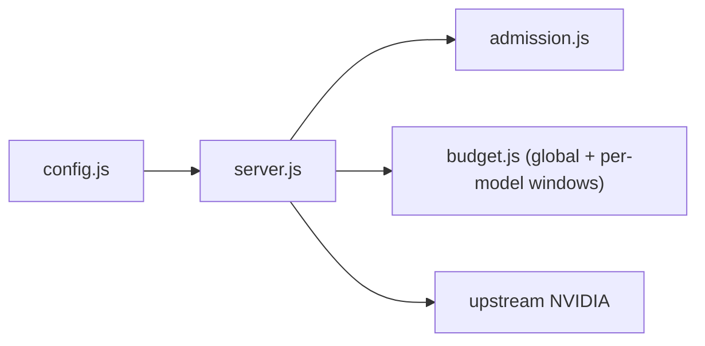

# e04s05: Apply per-model budgets atomically

* Issue: [#18](https://github.com/ak-a-ra/nvidia-api-proxy/issues/18)
* Parent issue: [#13](https://github.com/ak-a-ra/nvidia-api-proxy/issues/13)
* Type: feat
* Risk: P0
* Context: infra
* Status: failing

## 1. Business narrative

The proxy validates `PROXY_MODEL_LIMITS_JSON` since e04s01 and enforces the
global RPM/TPM budget since e04s04, but the per-model map is never read at
request time. An operator who sets `{"nemotron": {"rpm": 5, "tpm": 5000}}` gets
no per-model enforcement: one client loop targeting a single model can exhaust
the shared upstream quota for that model while staying inside the generous
global budget. This story turns the validated per-model map into a live
enforcement point, applied atomically with the global budget so a request is
either admitted by both or rejected by one.

Per-model enforcement stays opt-in: a deployment without `PROXY_MODEL_LIMITS_JSON`
behaves exactly as it did after e04s04, with the global budget as the sole gate.

## 2. Problem statement

A validated-but-unenforced per-model budget is a budget that appears to exist
and does not. Enforcing it requires three things the codebase did not have:

1. **Model extraction** — the estimator must return the model ID from the
   request body so the gate can look it up.
2. **Per-model windows** — each model named in the config needs its own rolling
   60-second RPM/TPM window pair, with the same effective-limit arithmetic and
   safety margin as the global windows.
3. **Atomic admission** — a request must pass both the global budget and the
   per-model budget (if the model is configured) in one decision, so a request
   that would exceed the model budget is never charged against the global
   window.

## Requirements (delta tags)

### ADDED: The estimator returns the model ID

`estimateCost` returns a `model` field: the `json.model` string when the body
is parseable and names one, or `null` otherwise. No normalization, no
case-folding — the model ID is matched exactly as the operator wrote it in
`PROXY_MODEL_LIMITS_JSON`.

### ADDED: Per-model rolling windows

`budget.js` holds one window pair per model named in `config.modelLimits`,
created lazily on first reservation for that model. Each window has its own
effective RPM/TPM limits derived from the per-model entry and the same safety
margin as the global windows. A model entry supplying only `rpm` or only `tpm`
enforces only that dimension; the other is uncapped for that model.

### MODIFIED: Reservation is atomic across global + model

**Before:** `budget.reserve(cost)` checks only the global windows and charges
on admission.

**After:** `budget.reserve(cost)` checks the global windows and, when the
request names a model with a configured budget, the model's windows too. Only
when both pass are both charged. A request rejected by the model budget is
never charged against the global window.

### MODIFIED: The 429 response names the tighter constraint

**Before:** The 429 carries `reason: "rpm"` or `reason: "tpm"` from the global
window.

**After:** The 429 carries `reason: "model_rpm"` or `reason: "model_tpm"` when
the model budget is the tighter constraint. The `Retry-After` is derived from
the tighter window's oldest reservation.

### ADDED: Unknown models fall through to global only

A request body naming a model not in `PROXY_MODEL_LIMITS_JSON`, or naming no
model, is admitted by the global budget alone — no per-model check. This is
the correct behavior: an operator who configured limits for three models
wants the other models governed by the global budget, not rejected.

### MODIFIED: The existing per-model-limits-accepted test

**Before:** The e04s04 test `per-model limits are accepted and do not change
global behavior` asserts two requests are admitted by the global budget even
though the model budget is `rpm: 1, tpm: 1`.

**After:** The test is updated: two requests for the configured model are
rejected by the model budget when they exceed it, demonstrating enforcement.
A request for an unconfigured model still passes through to global only.

## 3. Actors

* **Client application** — calls `/v1/*` with a Bearer token, a request body
  naming a model.
* **Proxy** — estimates, extracts the model, reserves globally and per-model
  atomically, forwards or rejects.
* **Upstream (NVIDIA NIM)** — sees the original bytes, never the estimate.
* **Operator** — sets `PROXY_MODEL_LIMITS_JSON` alongside the global pair.

## 4. Preconditions

* Global rate limiting enabled (both `PROXY_RPM` and `PROXY_TPM` set).
  Per-model limits without the global pair are accepted by config.js (the
  map is stored regardless), but the rate gate is not entered — the per-model
  budget has no effect when the global budget is disabled.
* `PROXY_MODEL_LIMITS_JSON` parsed and stored by `config.js` as a
  null-prototype map — no change to config parsing.

## 5. Solution and main flow

1. `estimateCost` gains a `model` field: `json.model` when it is a non-empty
   string, `null` otherwise. The field is informational for the caller.
2. `createBudget` accepts `modelLimits` (the config map) as a third argument.
   When non-null, it builds one window pair per model entry at construction
   time (not lazily — the map is small and the operator declared it).
3. `reserve(cost)` checks global first. If the global rejects, return
   immediately (no model check needed). If the global admits tentatively,
   look up `cost.model` in the model windows. If the model rejects, return
   the model rejection (global is not charged). If both admit, charge both.
4. `server.js` passes `config.modelLimits` to `createBudget` — one line change.
5. The `estimateCost` call in server.js already passes the parsed JSON, so the
   model field flows through automatically.

### Module map after this story



## 6. Constraints and alternative flows

* **No lazy window creation.** The model map is bounded by the operator's
  config; creating windows at construction is deterministic and avoids a
  race between the first two requests for the same model.
* **No model normalization.** Model IDs are matched exactly as written. The
  operator controls both sides (the config and the client's request body).
  Case-folding or trimming would create a matching rule the operator cannot
  predict.
* **Per-model limits without global pair.** The config accepts this (the map
  is stored), but the rate gate is not entered: per-model budgets only
  activate when the global budget is enabled. This is documented, not a bug.
* **Partial model entry.** An entry with only `rpm` enforces only RPM for
  that model; TPM is uncapped. Same in reverse. This is already how config.js
  validates — an entry must supply at least one of `rpm` or `tpm`.
* **Budget waiting** deferred to a later story as noted in e04s04 §6.
* **SSE reconciliation** — actual usage vs. estimated usage is e04s06.

## 7. Domain glossary

* **Model window** — a per-model RPM/TPM window pair, same 60-second rolling
  horizon as the global window.
* **Atomic reservation** — global and model windows charged together or not
  at all.
* **Model ID** — the `model` field from the request body JSON, matched exactly
  against `PROXY_MODEL_LIMITS_JSON` keys.

## 8. Interfaces and contracts

`budget.js` exports (changes in **bold**):

```
createBudget(rateLimit, limits, **modelLimits**) -> { enabled, effective, **modelEffective**, reserve, release, close }
estimateCost(json, buffer) -> { inputTokens, outputTokens, requestCharge, totalTokens, fallback, **model** }
effectiveLimit(limit, safetyMarginPct) -> number
```

* `reserve(cost)` unchanged signature. When `cost.model` matches a configured
  model, the model window is also checked. Return shape gains
  `reason: "model_rpm" | "model_tpm"` variants.
* `modelEffective` is a map of `{ [model]: { rpm?, tpm? } }` with effective
  limits, or `null` when no model limits are configured.
* `close()` closes all model windows alongside the global windows.

## 9. Configuration

No new variables. `PROXY_MODEL_LIMITS_JSON` changes from "validated and
stored" to "read at request time via budget.js":

| Variable | Before | After |
|---|---|---|
| `PROXY_MODEL_LIMITS_JSON` | validated and stored, not enforced | per-model RPM/TPM windows, enforced atomically with global |

## 10. Data and state

Per-model window state lives in `budget.js` only, as a map of window pairs
keyed by model ID. No persistence, no cross-request state elsewhere.

## 11. Invariants

1. Per-model limits disabled ⇒ zero behavioral change from e04s04.
2. Global budget disabled ⇒ per-model budgets have no effect (gate not entered).
3. Reservation is atomic: both global and model pass, or neither is charged.
4. Unknown model ⇒ global budget only, no rejection.
5. Model IDs matched exactly, no normalization.
6. Effective model limits use the same safety margin as global.
7. Each model window uses the same 60-second rolling horizon.
8. `close()` closes all model windows.
9. 429 `Retry-After` is derived from the tighter constraint's window.

## 12. Failure modes

| Failure | Answer |
|---|---|
| Over model RPM budget | `429 { "error": "Too many requests" }` with model window's Retry-After |
| Over model TPM budget | `429 { "error": "Too many requests" }` with model window's Retry-After |
| Over global budget | `429 { "error": "Too many requests" }` unchanged from e04s04 |
| Unknown model | admitted by global only |
| No model in body | admitted by global only |
| Config without global pair | per-model limits stored but not enforced |

## 13. Security and privacy

* No new secret exposure: the 429 body remains generic.
* The model ID from the request body is used as a map key lookup only; it is
  never logged, returned, or stored beyond the request lifetime.
* Auth unchanged.

## 14. Observability

No new log line. The model ID is deliberately not added to the log line's
closed field set — that decision belongs to a later observability story.

## 15. Dependencies

None added. `budget.js` continues to use only `Date.now` and array operations.

## 16. Risks and assumptions

* **Window count** — one window pair per configured model. A large model map
  creates many arrays, but config.js already validates the entries so the count
  is bounded by operator intent.
* **Estimator accuracy** — per-model estimates carry the same accuracy as
  global estimates (same estimator, same fallback). Under-counts overspend the
  model budget; the safety margin is the operator's control.
* **Model ID mismatch** — if the client sends a model ID that differs in case
  from the config key, it falls through to global only. Documented, not a bug.

## 17. Acceptance criteria (Gherkin)

```gherkin
Feature: per-model budgets applied atomically

  Scenario: no model limits configured
    Given PROXY_RPM and PROXY_TPM are set
    And PROXY_MODEL_LIMITS_JSON is absent
    When requests arrive inside the global budget
    Then all are admitted by the global budget alone

  Scenario: model RPM limit enforced
    Given PROXY_MODEL_LIMITS_JSON sets model "nemotron" with rpm 2
    And the global RPM budget is generous (60)
    When three requests name model "nemotron"
    Then the first two are admitted
    And the third is answered 429 with reason model_rpm
    And Retry-After is a positive integer

  Scenario: model TPM limit enforced
    Given PROXY_MODEL_LIMITS_JSON sets model "nemotron" with tpm 100
    And the global TPM budget is generous (100000)
    When a request's estimated cost exceeds 100 tokens for "nemotron"
    Then the request is answered 429

  Scenario: unknown model falls through to global
    Given PROXY_MODEL_LIMITS_JSON sets model "nemotron" with rpm 1
    When a request names model "llama" (not in config)
    Then it is admitted by the global budget
    And no model window is consulted

  Scenario: atomic reservation — model rejection does not charge global
    Given global RPM 3 and model "nemotron" RPM 1
    When two requests name "nemotron"
    Then the first is admitted (global and model charged)
    And the second is rejected by the model budget
    And the global RPM counter is 1, not 2

  Scenario: partial model entry — rpm only
    Given PROXY_MODEL_LIMITS_JSON sets "nemotron" with rpm 2 (no tpm)
    When three requests for "nemotron" arrive
    Then the first two are admitted
    And the third is rejected for model_rpm
    And token usage is uncapped for that model

  Scenario: model limits without global pair
    Given PROXY_MODEL_LIMITS_JSON is set but PROXY_RPM/PROXY_TPM are absent
    When requests arrive
    Then per-model limits have no effect
    And requests are streamed through without buffering

  Scenario: close() closes model windows
    Given model limits are configured
    When close() is called (SIGTERM path)
    Then model windows refuse new reservations
```

## 18. Out of scope

SSE usage reconciliation (#19). Non-streaming reconciliation and terminal
fallbacks (#20). Aggregate stats and `/stats` (#21). Integration,
documentation, and the release pass (#22). Budget waiting (deferred from
e04s04 §6).

## 19. Zoom-out checks

### `budget.js` (modified)

* **Purpose**: own the numbers — global and per-model windows, effective
  limits, rolling windows, the estimator.
* **Callers**: `server.js` only.
* **Contracts**: gains `modelLimits` parameter; `estimateCost` returns
  `model` field; `reserve` checks model windows atomically; `close` closes
  all windows. No env reads, no defaults, no timers.

### `server.js` (modified)

* **Purpose**: HTTP entry; owns bytes and status codes.
* **Callers**: node.
* **Contracts**: one line change — passes `config.modelLimits` to
  `createBudget`. Every other path unchanged.

### `config.js` (unchanged)

* **Purpose**: config parsing and validation.
* **Change surface**: none. `modelLimits` is already parsed and stored.

### `admission.js` (unchanged)

* **Purpose**: concurrency ceiling and FIFO queue.
* **Change surface**: none.

## 20. Slopcheck

* No external packages. Zero-dependency constraint maintained.
* Does the change need to exist in `budget.js`? Yes — per-model windows are
  budget arithmetic, and `server.js` must not own window state.
* Is there a smaller change? No — the model extraction, the window map, and
  the atomic reservation are the minimum viable enforcement.
* Dead code: no budget wait, no SSE reconciliation, no stats path.

## 21. Risks

See §16.

## 22. Out-of-scope references

Issues #19–#22. ADR 0002 may need an amendment recording the per-model
enforcement decision.

## References

* Issue #18 — acceptance criteria.
* Issue #13 — parent epic, stories 59-61 and 135-138 name per-model budgets.
* `docs/adr/0002-config-operational-fail-fast.md` — regime.
* Existing tests: `describe("e04s04 global RPM/TPM budgets")` in
  `server.test.js` — the `per-model limits are accepted and do not change
  global behavior` test must be updated.
* `budget.js` line 130-133 — comment documenting that per-model distinctions
  are e04s05's job.
